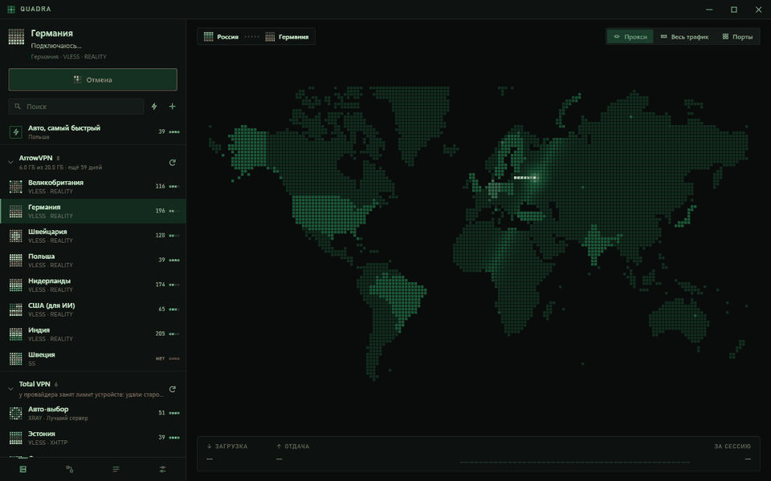
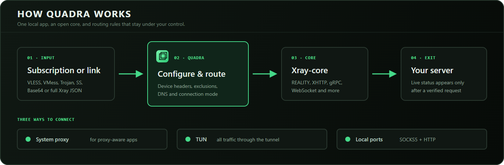
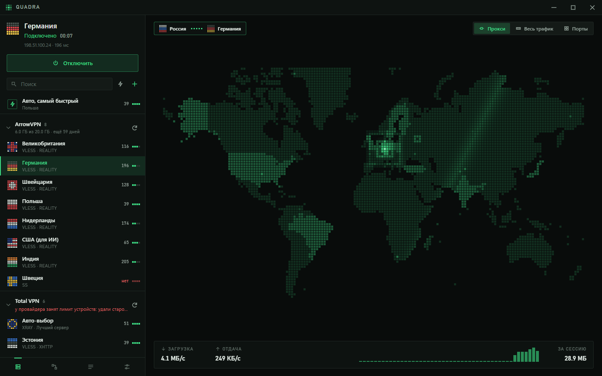
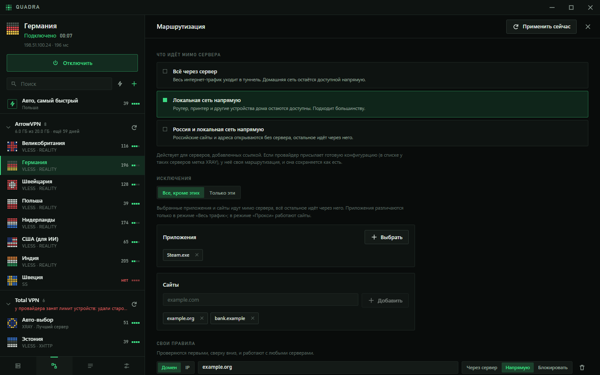
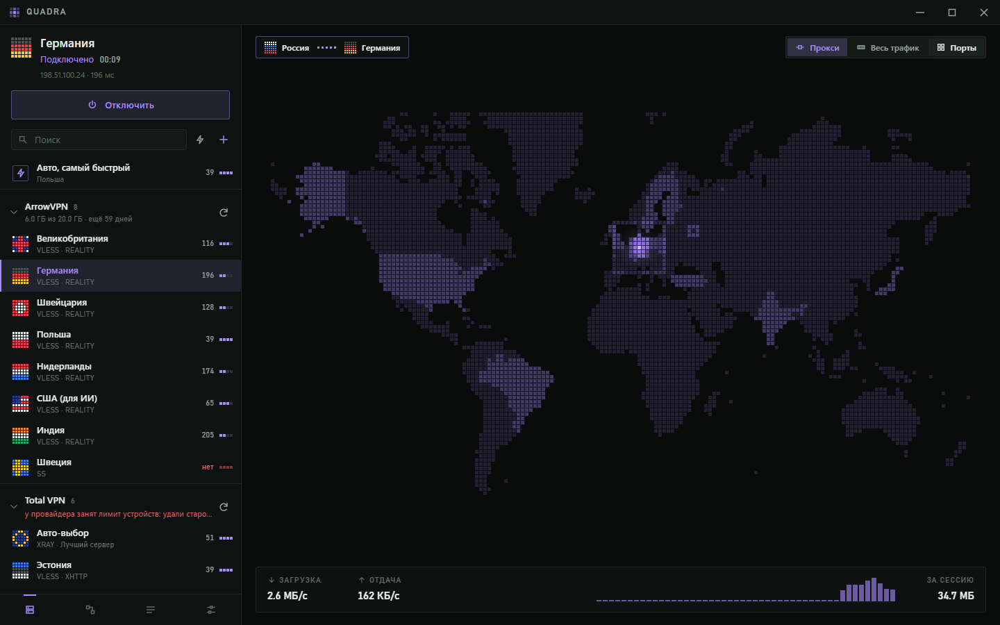
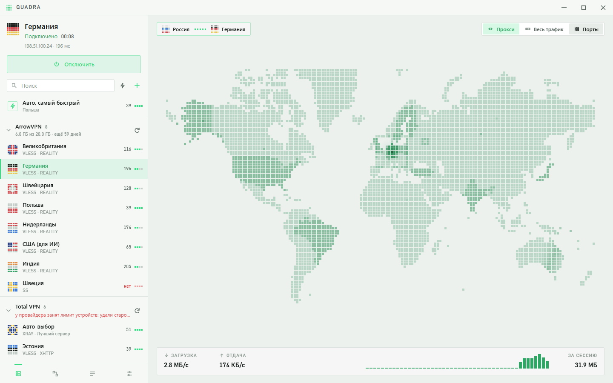

<p align="center">
  
</p>

<h1 align="center">Quadra</h1>

<p align="center">
  <a href="README.ru.md">Читать на русском</a>
</p>

## Fast to open. Fast to connect. Clear at a glance.

**Quadra** is a free, open-source client for VLESS and the other Xray protocols. It combines a quick Tauri shell, a responsive Svelte interface and Xray-core with a living world map that shows the route of your connection.

Quadra is **not a VPN provider**: there is no account to create and no built-in subscription to buy. Bring your own server or provider.

<div align="center">
  
</div>

## Why Quadra

| | |
|---|---|
| **Subscriptions that actually load** | Device headers (`x-hwid` and friends) let providers with device limits return the full server list instead of an “unsupported client” stub. This can be switched off. |
| **Bring almost anything** | Paste `vless://`, `vmess://`, `trojan://`, `ss://`, a Base64 list or a complete Xray JSON config. Drag a file onto the window or press Ctrl+V anywhere. |
| **Three connection modes** | Use the system proxy, route all traffic through TUN, or expose local SOCKS5 and HTTP ports without changing system settings. |
| **A connection you can see** | The block on the map travels from your location to the server. “Connected” appears only after a real request has passed through the tunnel. |
| **Routing without the fight** | Keep your LAN or a country direct, add domain/IP rules, and choose apps and sites to exclude — or the only ones to proxy. |
| **Make it yours** | Dark and light themes, eight accent palettes and a custom colour. The entire interface, including the map, follows your choice. |

Under the hood, connections are made by **[Xray-core](https://github.com/XTLS/Xray-core)**: REALITY, XHTTP, gRPC, WebSocket and the rest of the Xray ecosystem are supported.

## How it works

<div align="center">
  
</div>

1. **Add an input.** Import a subscription, share link, list or ready-made Xray configuration.
2. **Choose the route.** Quadra prepares device headers, DNS, exclusions and the connection mode.
3. **Start the core.** Xray-core handles the protocol and establishes the tunnel.
4. **Verify the exit.** The interface reports success only after a request confirms the connection.

## Download

Get the installer for your system from the **[latest release](https://github.com/not-omibranch/Quadra/releases/latest)**.

| System | File | Notes |
|---|---|---|
| Windows 10/11 | `Quadra_0.3.2_x64-setup.exe` | Per-user installation; administrator rights are not required for installation |
| macOS, Apple silicon | `Quadra_0.3.2_aarch64.dmg` | Unsigned build; see the first-launch note below |
| macOS, Intel | `Quadra_0.3.2_x64.dmg` | Unsigned build |
| Linux | `.deb`, `.rpm` or `.AppImage` | Requires WebKitGTK 4.1 |
| Android 8+ | `Quadra_0.3.2_android-arm64.apk` | Experimental; install the APK directly |

The desktop builds are not code-signed. On Windows, SmartScreen may ask once: choose **More info → Run anyway**. On macOS, right-click Quadra and choose **Open**, or run:

```sh
xattr -cr /Applications/Quadra.app
```

**Platform status.** Windows is the primary development platform. macOS and Linux are compiled, tested and smoke-started in CI, but should still be treated as previews. Android is experimental: automated emulator tests cover connecting, passing another app's traffic and disconnecting cleanly; physical-device testing is still needed.

## A closer look

| Connected | Routing |
|---|---|
|  |  |
| **Live connection** — exit address, latency, throughput and session traffic. | **Flexible routing** — presets, per-app/site exclusions and custom rules. |

| Appearance | Light theme |
|---|---|
|  |  |
| **Your palette** — one accent across the entire UI and map. | **Light or dark** — switch instantly, with no restart. |

## Build from source

You need **[Node.js](https://nodejs.org) 22+**, **[Rust](https://rustup.rs)** and the **[Tauri prerequisites](https://v2.tauri.app/start/prerequisites/)** for your system.

```sh
npm ci
node tools/fetch-xray.mjs     # download Xray-core and verify its checksum
npm run tauri dev             # run the app
npm run tauri build           # build the installer
```

For interface work, `npm run dev` starts the Svelte UI in a browser against a mock backend. No VPN or system proxy is touched.

```sh
cd src-tauri
cargo test
```

### Repository map

| Path | What lives there |
|---|---|
| `src/` | Svelte 5 interface; `lib/MapView.svelte` draws the map and connection animation |
| `src/app.css` | Theme, accent, sizing and motion variables |
| `src-tauri/src/` | Rust backend: subscriptions, links, Xray configuration and core lifecycle |
| `src-tauri/src/sys/` | Windows, macOS and Linux integration |
| `src-tauri/plugins/vpn/` | Android VPN service in Kotlin |
| `tools/` | Xray fetching, map generation, end-to-end checks and documentation capture |
| `.github/workflows/` | Cross-platform builds, tests, smoke checks, Android E2E and releases |

### Rebuild the README visuals

The screenshots and connection GIF are generated from the real browser interface, not a separate design mock-up. You need Chrome or Edge, plus Python with Pillow for GIF/icon assembly.

```sh
npm run docs:capture
npm run docs:assemble
```

The capture script starts a temporary local Vite server, uses the mock backend, saves every frame headlessly and stops the server when finished.

## Contribute

Issues and pull requests are welcome. Please keep the UI keyboard-accessible, put platform-specific behaviour in `src-tauri/src/sys/`, and never test routing by changing the developer's live VPN connection.

- [Report a bug](https://github.com/not-omibranch/Quadra/issues/new)
- [Browse releases](https://github.com/not-omibranch/Quadra/releases)
- [Read third-party notices](THIRD_PARTY.md)

## Licence

**[GPL-3.0](LICENSE)** from version 0.3.1: Quadra is free to use, study, modify and share, and derivative works must remain open under the same terms. Versions through 0.3.0 were released under MIT.
