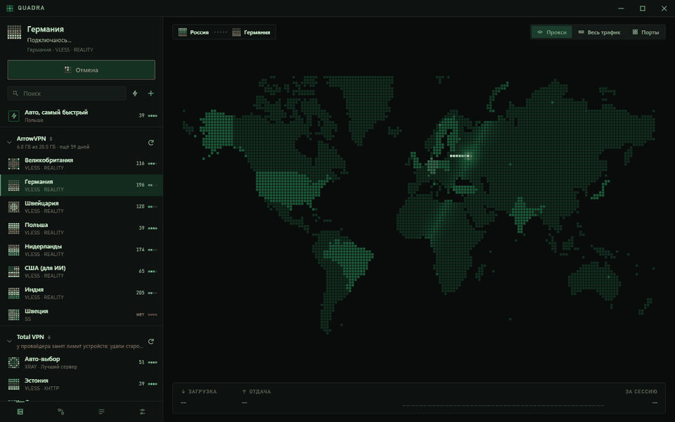
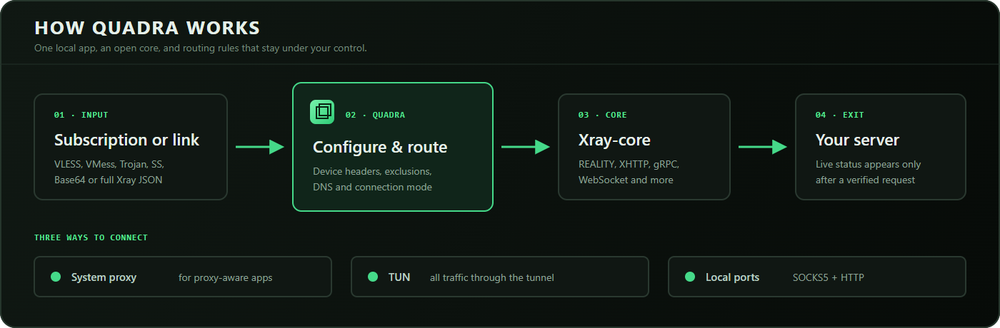
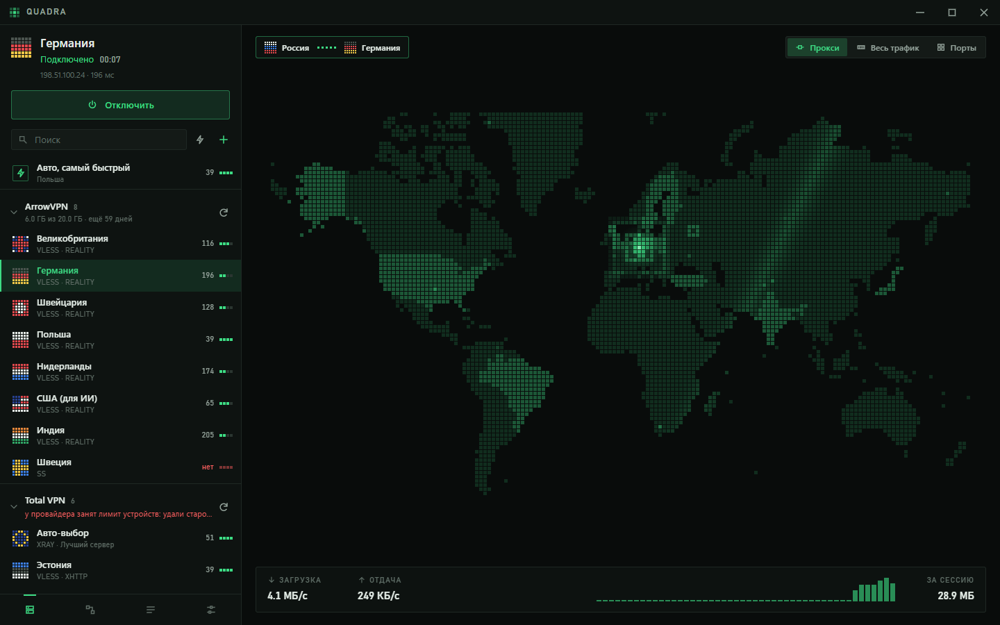
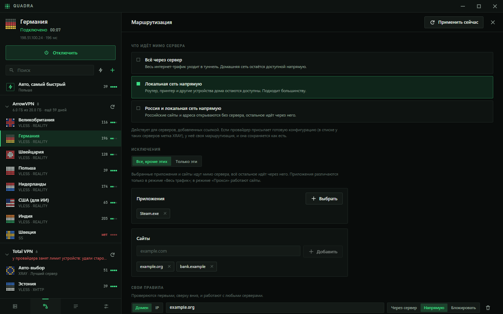
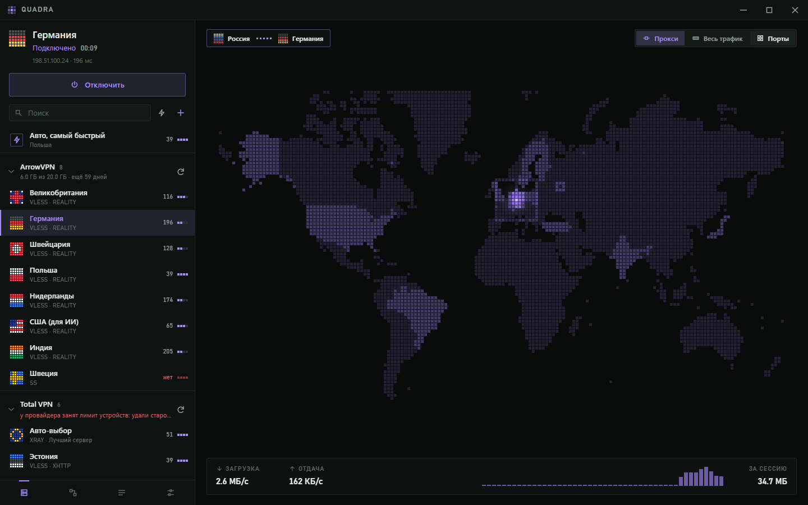
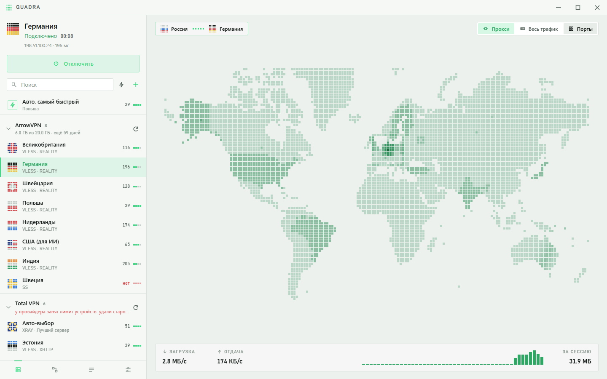

<p align="center">
  
</p>

<h1 align="center">Quadra</h1>

<p align="center">
  <a href="README.md">Read in English</a>
</p>

## Быстро открывается. Быстро подключается. Всё наглядно.

**Quadra** — бесплатный клиент с открытым кодом для VLESS и остальных протоколов Xray. Быстрая оболочка Tauri, отзывчивый интерфейс Svelte и живая карта мира, которая показывает маршрут соединения.

Quadra — **не VPN-провайдер**: не нужно создавать аккаунт или покупать встроенную подписку. Используй свой сервер или подписку любого совместимого провайдера.

<div align="center">
  
</div>

## Почему Quadra

| | |
|---|---|
| **Подписки действительно загружаются** | Заголовки устройства (`x-hwid` и другие) помогают провайдерам с лимитом устройств вернуть полный список серверов, а не заглушку «клиент не поддерживается». Их можно отключить. |
| **Почти любой формат** | Вставь `vless://`, `vmess://`, `trojan://`, `ss://`, список Base64 или готовый Xray JSON. Перетащи файл на окно или нажми Ctrl+V в любом месте. |
| **Три режима подключения** | Системный прокси, весь трафик через TUN или локальные порты SOCKS5 и HTTP без изменения системных настроек. |
| **Соединение видно на карте** | Блок проходит путь от твоей точки до сервера. Статус «Подключено» появляется только после настоящего запроса через туннель. |
| **Понятная маршрутизация** | Оставь локальную сеть или целую страну напрямую, добавь правила для доменов и IP, выбери исключения — или только те программы и сайты, которым нужен сервер. |
| **Внешний вид под тебя** | Тёмная и светлая темы, восемь акцентных палитр и свой цвет. Перекрашивается весь интерфейс, включая карту. |

Соединения устанавливает **[Xray-core](https://github.com/XTLS/Xray-core)**: поддерживаются REALITY, XHTTP, gRPC, WebSocket и остальные возможности экосистемы Xray.

## Как это работает

<div align="center">
  
</div>

1. **Добавь источник.** Подписку, ссылку, список серверов или готовую конфигурацию Xray.
2. **Выбери маршрут.** Quadra подготовит заголовки устройства, DNS, исключения и режим подключения.
3. **Запусти ядро.** Xray-core обработает протокол и установит туннель.
4. **Проверь выход.** Интерфейс сообщит об успехе только после подтверждающего запроса.

## Скачать

Выбери установщик в **[последнем релизе](https://github.com/not-omibranch/Quadra/releases/latest)**.

| Система | Файл | Примечание |
|---|---|---|
| Windows 10/11 | `Quadra_0.3.2_x64-setup.exe` | Установка для текущего пользователя, права администратора не нужны |
| macOS, Apple silicon | `Quadra_0.3.2_aarch64.dmg` | Сборка без подписи, см. инструкцию ниже |
| macOS, Intel | `Quadra_0.3.2_x64.dmg` | Сборка без подписи |
| Linux | `.deb`, `.rpm` или `.AppImage` | Нужен WebKitGTK 4.1 |
| Android 8+ | `Quadra_0.3.2_android-arm64.apk` | Экспериментальная версия, устанавливается APK-файлом |

Настольные сборки не подписаны сертификатом. Windows SmartScreen может спросить один раз: выбери **«Подробнее» → «Выполнить в любом случае»**. На macOS открой Quadra правой кнопкой и нажми **«Открыть»** или выполни:

```sh
xattr -cr /Applications/Quadra.app
```

**Состояние платформ.** Основная платформа разработки — Windows. Версии macOS и Linux собираются, тестируются и запускаются в CI, но пока остаются предварительными. Android экспериментальный: автоматический тест на эмуляторе проверяет подключение, прохождение трафика другого приложения и чистое отключение; проверка на физических устройствах ещё нужна.

## Поближе

| Подключение | Маршрутизация |
|---|---|
|  |  |
| **Живое соединение** — адрес выхода, задержка, скорость и трафик сессии. | **Гибкая маршрутизация** — готовые режимы, исключения и собственные правила. |

| Акцентный цвет | Светлая тема |
|---|---|
|  |  |
| **Твоя палитра** — один акцент для интерфейса и карты. | **Светло или темно** — переключение мгновенно, без перезапуска. |

## Сборка из исходников

Нужны **[Node.js](https://nodejs.org) 22+**, **[Rust](https://rustup.rs)** и **[зависимости Tauri](https://v2.tauri.app/start/prerequisites/)** для твоей системы.

```sh
npm ci
node tools/fetch-xray.mjs     # скачать Xray-core и проверить контрольную сумму
npm run tauri dev             # запустить приложение
npm run tauri build           # собрать установщик
```

Для работы над интерфейсом `npm run dev` откроет Svelte UI в браузере с подставным backend. Настоящий VPN и системный прокси при этом не затрагиваются.

```sh
cd src-tauri
cargo test
```

### Структура репозитория

| Путь | Что находится внутри |
|---|---|
| `src/` | Интерфейс Svelte 5; `lib/MapView.svelte` рисует карту и анимацию подключения |
| `src/app.css` | Переменные темы, акцента, размеров и движения |
| `src-tauri/src/` | Backend на Rust: подписки, ссылки, конфигурация Xray и жизненный цикл ядра |
| `src-tauri/src/sys/` | Интеграция с Windows, macOS и Linux |
| `src-tauri/plugins/vpn/` | Android VPN service на Kotlin |
| `tools/` | Загрузка Xray, генерация карты, E2E-проверки и съёмка документации |
| `.github/workflows/` | Кроссплатформенные сборки, тесты, smoke-проверки, Android E2E и релизы |

### Пересобрать изображения для README

Скриншоты и GIF создаются из настоящего браузерного интерфейса, а не из отдельного дизайн-макета. Нужен Chrome или Edge, а также Python с Pillow для сборки GIF и иконок.

```sh
npm run docs:capture
npm run docs:assemble
```

Скрипт сам запускает временный локальный Vite-сервер, использует подставной backend, сохраняет кадры в headless-режиме и останавливает сервер после завершения.

## Участие в проекте

Issues и pull request приветствуются. Сохраняй управление с клавиатуры, размещай платформенный код в `src-tauri/src/sys/` и не проверяй маршрутизацию, меняя действующее VPN-соединение разработчика.

- [Сообщить об ошибке](https://github.com/not-omibranch/Quadra/issues/new)
- [Все релизы](https://github.com/not-omibranch/Quadra/releases)
- [Уведомления сторонних компонентов](THIRD_PARTY.md)

## Лицензия

**[GPL-3.0](LICENSE)** начиная с версии 0.3.1: Quadra можно свободно использовать, изучать, менять и распространять, а производные работы должны оставаться открытыми на тех же условиях. Версии до 0.3.0 включительно выпущены под MIT.
